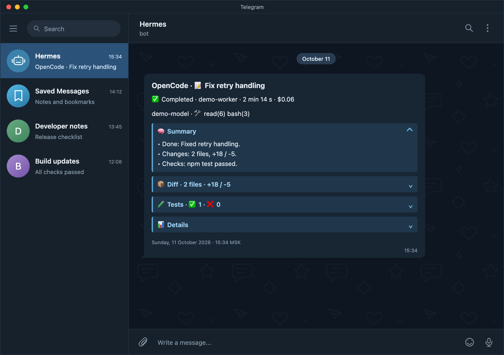

# OpenCode Hermes

[](https://github.com/klipbn/opencode-hermes/releases/latest)
[](https://github.com/klipbn/opencode-hermes/actions/workflows/ci.yml)
[](https://nodejs.org/)
[](https://www.python.org/)
[](LICENSE)

**Watch OpenCode sessions and get useful updates in Telegram through Hermes.**
Per-turn summaries, session diffs, test results, usage, and live OpenCode windows.

## Preview



*Simulated dark-theme Telegram Desktop screenshot with fictional chats and actual notification renderer output. Client presentation may vary.*

## What it does

OpenCode loads the watcher as a plugin. It records session events and delivers notifications. The Hermes control plugin reads that state and exposes slash commands. Hermes provides the Telegram gateway and the `hermes send` CLI.
The control plugin itself never calls an LLM.

```text
OpenCode → watcher → local state ← Hermes control ← slash commands
                    └→ Telegram notifications
```

| Component | Version | Source |
|---|---|---|
| `hermes-watch` | 3.12.0 | [watcher/](watcher/) |
| `opencode-control` | 1.9.0 | [opencode-control/](opencode-control/) |

**Repository release: [v1.2.0](https://github.com/klipbn/opencode-hermes/releases/tag/v1.2.0).** The watcher and control plugin have independent versions and release histories.

See [CHANGELOG.md](CHANGELOG.md) for repository releases and component changelogs for runtime changes.

## Releases

Download the tested watcher and control source ZIPs from
[GitHub Releases](https://github.com/klipbn/opencode-hermes/releases/latest).
Every release includes `SHA256SUMS`; verify downloaded archives with `shasum -a 256 -c SHA256SUMS`
or `sha256sum -c SHA256SUMS`. Each component archive includes its source, version metadata,
changelog, README, and MIT LICENSE. GitHub also provides the tagged repository source archive.

## Quick start

Requires OpenCode, [Hermes Agent](https://github.com/NousResearch/hermes-agent),
Node **22.13+**, and Python **3.9+**. The local worker/plugin setup supports macOS and Linux.

```sh
git clone https://github.com/klipbn/opencode-hermes.git
cd opencode-hermes
mkdir -p "$HOME/.config/opencode/plugins" "$HOME/.hermes/plugins"
cp watcher/hermes-watch.ts "$HOME/.config/opencode/plugins/hermes-watch.ts"
cp -R opencode-control "$HOME/.hermes/plugins/"
hermes plugins enable opencode-control
```

Start a new OpenCode process to load the watcher. Set up the Hermes Telegram gateway
before expecting notifications. In Hermes, use `/ochelp`, `/hstatus`, and `/oc`.

Use `$HERMES_HOME/plugins/` instead of `~/.hermes/plugins/` when Hermes has a custom home.
If an existing gateway has not loaded the commands, restart that gateway after its active work completes.
Full instructions: [installation](docs/installation.md).

## Commands

| Need | Command |
|---|---|
| Current sessions | `/oc` |
| Last turn summary | `/ocsum [target]` |
| Recorded tests | `/octests [target]` |
| Activity statistics | `/ocstats [days]` |
| Pause notifications | `/ocmute [minutes\|off\|levels]` |
| Health and setup | `/hstatus` |

`target` is a current list number or a session ID. Numbers can change when the list changes;
use a session ID for a durable reference. [Full command reference](opencode-control/README.md).

## Configuration

| Variable | Default | Purpose |
|---|---|---|
| `OPENCODE_HERMES_BASE_DIR` | `~/.cache/opencode-hermes` | Shared watcher/control state root |
| `OPENCODE_HERMES_NOTIFY` | `done,permission,reminder,retry,error` | Notification levels |
| `OPENCODE_HERMES_AI_SUMMARY` | `1` | AI turn summary; `0` uses a factual fallback |
| `OPENCODE_HERMES_HEARTBEAT_MS` | `10000` | Process heartbeat interval |

Keep the OpenCode and Codex state roots separate. Notification labels, help, diagnostics,
and the OpenCode AI-summary prompt are English. User-provided titles, agent replies,
and external errors are preserved in their original language.

See [installation](docs/installation.md) for all settings and
[the data contract](docs/data-contract.md) for ownership, retention, and compatibility.

## What is sent

The notification includes the session title and project, turn outcome, and the available
summary and observations. OpenCode can include SDK session diffs, recognized tests, tools,
and recorded token/cost values. Codex includes the original final response and available
test/model/timing observations; unavailable diff, cost, or token values remain unavailable.

Completed/error turns try rich HTML sections. If credentials are missing, the request
times out, or the configured Bot API does not support `sendRichMessage`, delivery falls
back to `hermes send` with expandable blockquotes. Permission and reminder notifications
are concise. Footers use English dates and Moscow time. [Examples](docs/notifications.md).

## Limits and privacy

- A turn completion is not a guarantee that the whole task succeeded; missing exit codes stay `unknown`.
- Session diffs come from OpenCode SDK, never the repository's overall `git status`.
- Active headless `serve`/`mcp` work is visible; empty headless processes are not presented as terminal windows.
- Per-turn claims prevent concurrent duplicate finalizations within one process, but crash-safe exactly-once delivery is not promised.
- State and Telegram messages can contain task titles, answers, file paths, and test commands. Choose the recipient accordingly.
- Tokens and private configuration stay outside the repository and are not recorded in state or logs by these components.

## Development

```sh
npm ci --prefix watcher --ignore-scripts
npm --prefix watcher run typecheck
npm --prefix watcher test
python3 -m unittest discover -s tests -p 'test_*.py'
python3 scripts/package.py watcher
python3 scripts/package.py control
```

The watcher runs TypeScript directly; npm packages are development dependencies.
Python uses the standard library. Tests use temporary state and fake SDK/delivery boundaries.
Builds place MIT-licensed source ZIPs in ignored `dist/`; no installation or publication occurs.

[Contributing](CONTRIBUTING.md) · [Release process](docs/releasing.md)

## License

[MIT](LICENSE)
